# Символьные строки в Си. Ввод и вывод строк

Во многих языках программирования существует отдельный базовый тип данных, предназначенный для хранения строк. В языке Си нет специального типа данных для хранения строк. Но, конечно, это не означает, что с помощью языка Си невозможно хранить и обрабатывать в программах строковые данные.

Задумаемся на секунду, что такое строка? Строка -- это всего лишь упорядоченный набор из символов, т.е. массив символов. Создавать массивы из элементов типа `char` мы умеем, а значит, по большому счёту, у нас уже есть структура, позволяющая сохранить любую строку в своей программе. Осталось лишь разобраться в некоторых нюансах. Приступим!

## Объявление и инициализация строк в Си

В следующем листинге мы создадим и проинициализируем сразу две строки:

Листинг 1. Объявление и инициализация строк в Си
```c
char first_name[6] = { 'G', 'i', 'l', 'l', '\0' }; 
char last_name[] = { 'B', 'y', 't', 'e', 's', 0 };
```

Здесь мы объявили символьные массивы `first_name` и `last_name`, а заодно проинициализировали их самым обыкновенным способом. Единственное, на что здесь стоит обратить внимание, так это на управляющий символ `'\0'`, который добавлен последним элементом. Это управляющий символ, которым в языке Си обозначается конец строки. Его ещё называют =нуль-символом= или =нуль-терминатором=.

Кстати, код этого символа в таблице `ASCII` тоже равен нулю `0`. Поэтому при непосредственной инициализации строк можно использовать как `'\0'`, так и число `0`. Именно так мы и поступили при инициализации строки `last_name`. Собственно, мы могли бы все символьные литералы заменить их ASCII-кодами, а не только нуль-символ.

Инициализировать строки таким образом не очень-то удобно. К счастью, есть более простой синтаксис, позволяющий сделать то же самое, но гораздо проще.

Листинг 2. Создание и инициализация строк с помощью строковых литералов
```c
char first_name[6] = "Gill";
char last_name[] = "Bytes";
```

Здесь в качестве инициализатора выступает строковый литерал, т.е. уже привычная нам строка, записанная в двойных кавычках. При таком подходе компилятор сам добавит нуль-символ в конец строки, если для него там есть место. Согласитесь, что этот способ гораздо удобнее и нагляднее.

Оба варианта создают абсолютно идентичные символьные массивы, изображённые на следующем рисунке:

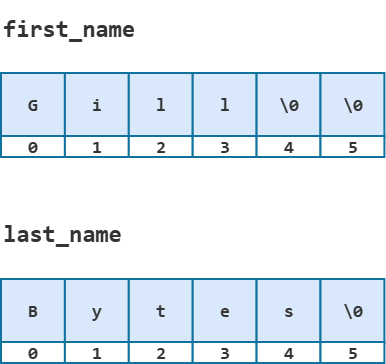

Обратите внимание, что правило частичной инициализации сработает для массива `first_name` как в первом, так и во втором случае. 

Дополнительно проиллюстрируем, как выглядят эти же массивы с точки зрения оперативной памяти:

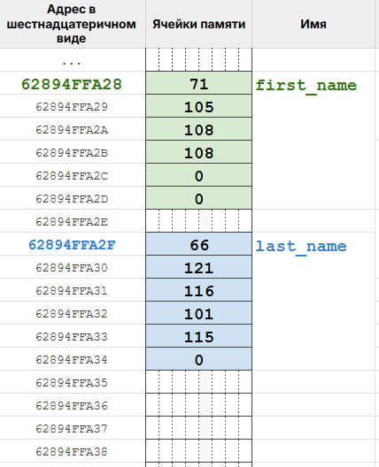

Итого: для хранения строк в языке Си используются символьные массивы с нуль-символом `\0`, которым обозначается конец строки. Строки с нуль-символом на конце иногда называют =C-строками= или =строками в стиле C=. 

Обратите внимание, что если в символьном массиве отсутствует `\0`, то такой массив не является =корректной C-строкой=. При этом в символьном массиве может быть более одного нуль-символа. В таком случае концом строки является самый первый из них.

=Длина строки= -- это количество символов от начала строки до первого нуль-символа, не считая его. 

% **Важно!** Размер массива и длина строки -- это разные величины. Размер символьного массива всегда хотя бы на единицу больше длины корректной C-строки.

Например: размер массива `first_name` равен `6`, длина строки -- `4`. Размер массива `last_name` тоже равен `6`, в то время как длина строки -- `5`.


## Как вывести строку на экран в Си

Вывод строки на экран, или, говоря точнее, в стандартный поток вывода `stdout`, можно реализовать несколькими способами.

### Посимвольный вывод строки

Строка -- это в первую очередь массив символов, а значит к любому из них можно обратиться по индексу: `first_name[0]`, `first_name[1]` и т.д. Это позволяет нам пройтись по строке циклом и напечатать её символ за символом, используя `putchar` или `printf` со спецификатором `%c`.

Листинг 3. Посимвольный вывод строк
```c
#include <stdio.h>

int main(void)
{
        char first_name[6] = "Gill";
        char last_name[] = "Bytes";

        for (int i = 0; first_name[i] != '\0'; i++) {
                printf("%c", first_name[i]);
        }
        printf("\n");

        for (int i = 0; last_name[i]; i++) { // т.к. код символа `\0` это 0
                                             // то last_name[i] != 0 можно
                                             // сократить до last_name[i]
                putchar(last_name[i]);
        }
        printf("\n");

        return 0;
}
```


Нуль-символ `\0` в конце строки помогает нам вовремя прервать цикл.

Посимвольный вывод из Листинга 3 -- это самый "лобовой" способ вывести строку. Но то же самое можно сделать с помощью функций стандартной библиотеки. Мы разберём две из них:
- функцию `puts`;
- функцию форматного вывода `printf` со спецификатором `%s`.


### Функция `puts`

Функция `puts` (сокращение от put string) объявлена в заголовочном файле `stdio.h`. Использовать её довольно просто: достаточно передать ей в качестве аргумента саму строку, и она выведет её целиком.

Перепишем программу из Листинга 3 с использованием этой функции.

Листинг 4. Вывод строк с помощью функции `puts`
```c
#include <stdio.h>

int main(void)
{
        char first_name[6] = "Gill";
        char last_name[] = "Bytes";

        puts(first_name);
        puts(last_name);

        return 0;
}
```

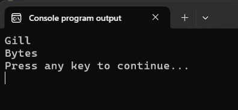


% **Обратите внимание!** Функция `puts` добавляет к выводу перенос строки `\n`. 

Теперь посмотрим на прототип функции `puts`.

Листинг 5. Прототип функции `puts`
```c
int puts(const char *s);
```

Функция принимает указатель на `char`, или иными словами адрес элемента типа `char`. Начиная с этого адреса она печатает символы до тех пор, пока не встретит `\0`. 

Когда мы пишем `puts(first_name)`, имя массива превращается в указатель на его нулевой элемент. Поэтому печать начинается с самого начала строки. 

Но ничего не мешает нам передать в `puts` указатель на любой другой символ строки. Тогда она выведет строку начиная с него. Разберём на примере.

Листинг 6.
```c
#include <stdio.h>

int main(void)
{
        char username[] = "Gi11_Byte$";

        puts(username);
        puts(&username[5]);

        return 0;
}
```

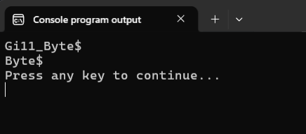

При первом вызове функция `puts` получает имя массива `username`, которое превращается в указатель на `username[0]`. Поэтому она выводит на экран всю строку `Gi11_Byte$`.

Второй вызов `puts` чуть хитрее. Здесь мы передаём ей `&username[5]` -- адрес элемента с индексом `5`, т.е. символа `'B'`. Сама функция `puts` не знает, что это середина массива. Для неё важно лишь то, что это адрес элемента типа `char`. Поэтому она спокойно проглатывает этот адрес и, начиная с него, выводит элементы массива на экран, пока не встретит нуль-символ. В итоге второй вызов выведет на экран `Byte$`.

Основное неудобство функции `puts` в том, что она всегда добавляет перенос строки, и нет никакой возможности на это повлиять. Этого недостатка лишена уже знакомая нам функция `printf`.

### Спецификатор `%s` в функции `printf` 

Для вывода строк у функции `printf` есть спецификатор `%s`. В отличие от `puts`, перенос строки она не добавляет. Перепишем с её помощью Листинг 3.

Листинг 7. Вывод строки с помощью функции `printf`
```c
#include <stdio.h>

int main(void)
{
        char first_name[6] = "Gill";
        char last_name[] = "Bytes";

        printf("|%s|", first_name);
        printf("\n");

        printf("|%s|", last_name);
        printf("\n");

        return 0;
}
```

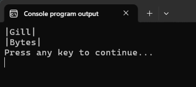

Символы `|` по краям показывают, где строка начинается и где заканчивается. Они помогают увидеть, что `printf` не добавляет перенос строки, и, кроме того, что нуль-символ на экране никак не отображается. Но он всё-таки нужен функции `printf`, чтобы понять, где остановиться.

А что будет, если нуль-символа в массиве нет?

Листинг 8. Вывод символьного массива без нуль-символа
```c
#include <stdio.h>

int main(void)
{
        // обычный символьный массив, т.к. нет нуль-символа
        char username[] = {'Y', 'o', 'u', 'n', 'g', 'C', 'o', 'd', 'e', 'r'};

        // Си-строка, т.к. есть нуль-символ
        char hello_phrase[] = {'H', 'i', '\0', ','};

        printf("%s %s", hello_phrase, username);
        printf("\n");

        return 0;
}
```

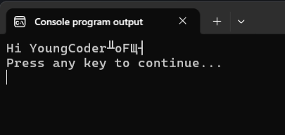

Здесь сразу два нюанса.

Во-первых, в массиве `hello_phrase` четыре символа, но на экран попало только `Hi`. Функция `printf` дошла до `\0` и остановилась. Запятая после нуль-символа в строку уже не входит, и её не видит ни одна строковая функция стандартной библиотеки.

Во-вторых, в массиве `username` нуль-символа нет вообще. Функция `printf` не понимает, где заканчивается массив, поэтому выходит за его границу и печатает всё, что лежит в памяти дальше, пока случайно не наткнётся на нулевой байт. Это неопределённое поведение: программа может вывести мусор, а может и упасть. Компилятор при этом, скорее всего, промолчит. Запустите программу у себя и сравните результат.

% **Важно!** Все строковые функции стандартной библиотеки ожидают корректную Си-строку, т.е. массив с нуль-символом на конце.

Главное достоинство `printf` -- форматированный вывод. Для `%s` работают уже знакомые нам ширина поля, точность и флаг `-`. Что делает каждый вариант, видно из комментариев и результата на рисунке.

Листинг 9. Использование модификаторов и флага `-` в спецификаторе `%s`
```c
#include <stdio.h>

int main(void)
{       
        char username[] = "Gi11_Byte$";

        printf("|%s|\n\n", username);     // обычный вывод строки

        printf("|%20s|\n\n", username);   // резервируем под вывод 20 знакомест

        printf("|%.4s|\n\n", username);   // выводим только первые 4 символа

        printf("|%20.4s|\n\n", username); // резервируем под вывод 20 знакомест
                                          // выводим только первые 4 символа

        printf("|%-20s|\n\n", username);  // резервируем под вывод 20 знакомест
                                          // прижимаем строку к левому краю  

        return 0;
}
```

")

Как видите, с выводом строк на экран всё довольно просто и понятно. Совсем другое дело -- прочитать произвольную строку из стандартного потока ввода. 

## Ввод строк в языке Си

Эта задача гораздо сложнее. Скажу даже больше, в языке Си нет какого-то одного универсального способа для решения этой задачи. Стандартная библиотека языка Си посредством заголовочного файла `stdio.h` предоставляет программисту несколько функций, позволяющих читать строки из `stdin`. Но каждая из этих функций имеет собственные нюансы и недостатки. Разбором этих сложностей мы сейчас и займёмся.

Но сперва давайте договоримся, что мы будем решать чуть более простую задачу. Будем исходить из того, что максимальная длина строки, которую должна корректно обрабатывать наша программа, ограничена каким-то конкретным числом, например, `1000` символов.

### Функция `fgets`

Рассмотрим прототип этой функции:

Листинг 10. Прототип функции `fgets`
```c
char *fgets(char *s, int size, FILE *stream);
```

Функция `fgets` принимает три аргумента:
- `s` -- указатель на символьный массив, куда будет записана строка;
- `size` -- размер этого массива;
- `stream` -- поток, из которого читаются данные. Мы читаем из стандартного потока ввода, поэтому всегда будем передавать `stdin`.

Хотя у функции `fgets` есть возвращаемое значение (указатель на `char`), мы пока что будем его игнорировать, используя функцию только ради её побочного эффекта -- записи строки в символьный массив.

Разберём работу функции на примере.

Листинг 11. Чтение строки с помощью функции `fgets`
```c
#include <stdio.h>

int main(void)
{
        char username[15];
        
        fgets(username, 15, stdin);
        printf("|%s|", username);
        
        return 0;
}
```

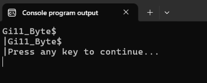

Вызов `fgets(username, 15, stdin);` читает строку из `stdin` и записывает её в массив `username` из `15` элементов.

% **Важно!** Функция `fgets` всегда резервирует один элемент массива под нуль-символ, чтобы в `username` получилась корректная C-строка. Поэтому из `stdin` будет прочитано **не более `size - 1` символов**.

Функция `fgets` читает символы из `stdin` по одному и останавливается, когда:
- прочитала символ перевода строки `\n`;
- прочитала `size - 1` символов, т.е. в нашем случае `14`;
- поток ввода закончился (`EOF`).

В примере выше я ввёл `Gi11_Byte$` и нажал `Enter`. В поток `stdin` попало `11` символов: `10` символов `Gi11_Byte$` и `\n`. Функция `fgets` прочитала их все, записала в массив `username`, а в следующий элемент сохранила нуль-символ `\0`.

Вот как выглядит массив `username` после вызова `fgets`:

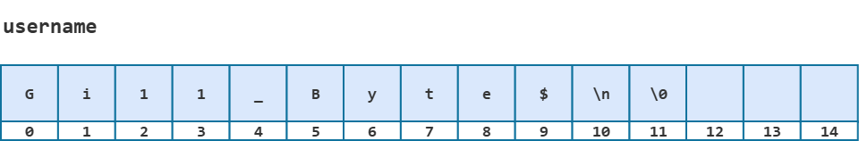

Обратите внимание: символ `\n` тоже попал в строку. Поэтому на экране второй символ `|` оказался на новой строке -- перед ним был напечатан `\n` из `username`.

А что будет, если ввести больше `14` символов? Например, `My name is Gill Bytes!`. Вместе с `\n` от клавиши `Enter` получится `23` символа.

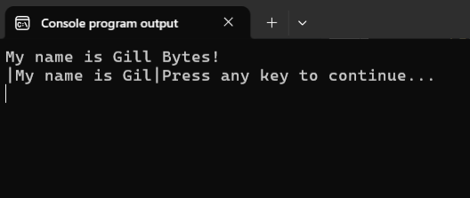

Функция `fgets` прочитала максимально возможные `14` символов, так и не встретив `\n`, записала их в массив `username` и добавила после них нуль-символ.

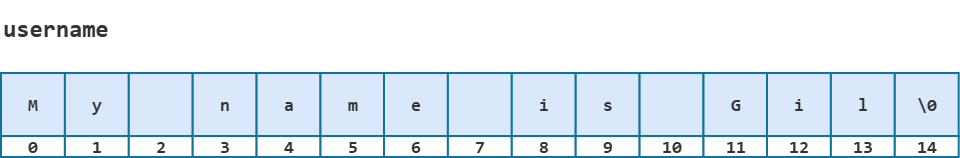

Оставшиеся символы `l Bytes!\n` так и остались лежать в потоке `stdin`. Любая следующая функция чтения из `stdin` уже не будет ждать нашего ввода, а сразу начнёт читать этот остаток. Совсем скоро мы в этом удостоверимся.

Пока же подытожим. Если не учитывать случай, когда поток ввода закончился, после вызова `fgets` возможны два исхода:
- строка поместилась в массив -- в конце строки есть `\n`
- строка не поместилась -- символа `\n` в массиве нет, а остаток строки лежит в `stdin`.

Продемонстрируем их на следующем примере.

Листинг 12.
```c
#include <stdio.h>

int main(void)
{
        char first_name[11];
        char last_name[11];
        
        printf("Enter your first name: ");
        fgets(first_name, 11, stdin);

        printf("Enter your last name: ");
        fgets(last_name, 11, stdin);

        printf("First Name: %s", first_name);
        printf("Last Name: %s", last_name);
      
        return 0;
}
```

Если ввести имя `Gill` и фамилию `Bytes`, программа работает правильно:

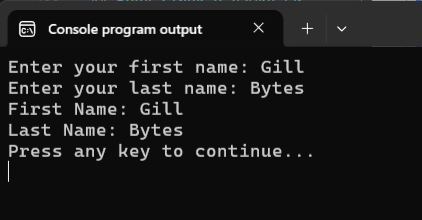


А теперь попробуем ввести имя `Christopher` (`11` символов) и фамилию `Moltisanti` (`10` символов). Обязательно попробуйте проделать это самостоятельно.

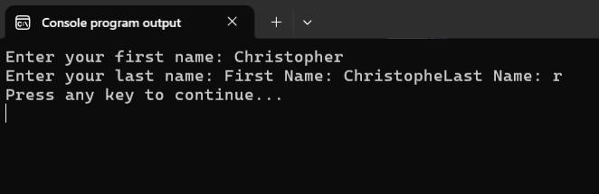

Программа не даёт нам ввести фамилию. Разберёмся, почему так происходит.

Мы ввели `Christopher` и нажали `Enter`, в поток `stdin` попало `12` символов: `Christopher\n`. Первый вызов `fgets` прочитал максимально допустимые `10` символов и `\n` не встретил. В `first_name` записана строка `Christophe`, а в `stdin` остались два символа `r\n`.

Затем программа вывела подсказку `Enter your last name: ` и снова вызвала `fgets`. Но поток ввода не пуст, поэтому `fgets` не стала ждать нашего ввода, а прочитала остаток `r\n` и остановилась на `\n`. В `last_name` записана строка `r\n`, а поток `stdin` теперь пуст.

Эти две строки и были выведены функциями `printf`.

Конечно, это не то поведение, на которое мы рассчитывали. Чтобы такого не было, после `fgets` нужно очистить поток `stdin`. Для этого будем в цикле читать из него символы, пока не встретим перевод строки `\n` или поток не закончится.

Листинг 13. "Очистка" стандартного потока ввода
```c
int current_char; 

// читаем символы из stdin, пока не встретим \n или конец потока EOF
do {
        current_char = getchar();
} while (current_char != '\n' && current_char != EOF); 
```

Добавим "очистку" потока в Листинг 12. А чтобы не дублировать этот цикл после каждого `fgets`, вынесем его в процедуру `discard_line`.

Заодно избавимся от "магического числа" `11`, заменив его именованной константой `MAX_LENGTH`, а в `fgets` будем передавать `sizeof` от массива. Так в `fgets` всегда будет передаваться правильный размер массива.

Листинг 14.
```c
#include <stdio.h>

#define MAX_LENGTH 11

void discard_line(void);

int main(void)
{
        char first_name[MAX_LENGTH];
        char last_name[MAX_LENGTH];
        
        printf("Enter your first name: ");
        fgets(first_name, sizeof(first_name), stdin);
        discard_line(); // очищаем поток stdin

        printf("Enter your last name: ");
        fgets(last_name, sizeof(last_name), stdin);
        discard_line();

        printf("First Name: %s", first_name);
        printf("Last Name: %s", last_name);
      
        return 0;
}

void discard_line(void)
{
        int current_char; 

        do {
                current_char = getchar();
        } while (current_char != '\n' && current_char != EOF);  
}
```

Запустим программу с теми же данными.

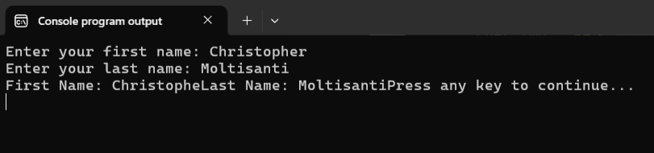

И снова здравствуйте! А я предупреждал, что считать строку со стандартного потока ввода не так-то просто. 

Фамилию теперь ввести можно, но строки на экране слиплись. В `printf` мы не пишем `\n`, так как рассчитываем на тот `\n`, который `fgets` сохраняет в строке. Но `Christopher` и `Moltisanti` не поместились в массивы целиком, и до `\n` дело не дошло. Чтобы исправить эту проблему, пока просто увеличим массивы, например, до `25` символов, а к символу `\n` вернёмся чуть позже.

Но это ещё не всё. Введём снова короткое имя `Gill`. Подсказка `Enter your last name: ` не появляется -- программа как будто зависла. Если теперь ввести фамилию, она пропадёт: её прочитает `discard_line`, и только после этого программа попросит ввести фамилию.

Дело в том, что `fgets` прочитала строку `Gill\n` целиком, и поток `stdin` остался пуст. Функции `getchar` внутри `discard_line` читать нечего (`stdin` же пустой), поэтому она ждёт нового ввода и съедает его.

Вывод: очищать поток нужно только тогда, когда функция `fgets` остановилась из-за нехватки места.

Проблема в том, что `fgets` не сообщает, почему она остановилась. Узнать это можно только по содержимому строки: если в ней есть `\n`, строка прочитана целиком, если нет -- в `stdin` остался хвост. Вы тоже ощущаете эту боль? Да-да, ребята, я с вами!

Что ж, делать нечего, давайте напишем функцию, которая проверяет, есть ли в строке символ `\n`.

Листинг 15.
```c
int string_has_newline_char(const char *str)
{
        int has_newline = 0;

        for (int i = 0; str[i]; i++) {
                if (str[i] == '\n') {
                        has_newline = 1;
                        break;
                }
        }

        return has_newline;
}
```

Функция возвращает `1`, если в строке есть `\n`, и `0`, если нет. Условие цикла `str[i]` -- это сокращённая запись `str[i] != '\0'`, как в Листинге 3.

Перепишем Листинг 14: увеличим массивы до `25` элементов и будем вызывать `discard_line` только тогда, когда в строке нет `\n`.

Листинг 16.
```c
#include <stdio.h>
#define MAX_LENGTH 25

void discard_line(void);
int string_has_newline_char(const char *str);

int main(void)
{
        char first_name[MAX_LENGTH];
        char last_name[MAX_LENGTH];
        
        printf("Enter your first name: ");
        fgets(first_name, sizeof(first_name), stdin);
        
        // если строка first_name не содержит символа `\n`
        if (!string_has_newline_char(first_name)) {
                discard_line(); // очищаем поток stdin
        }

        printf("Enter your last name: ");
        fgets(last_name, sizeof(last_name), stdin);
        if (!string_has_newline_char(last_name)) {
                discard_line(); // очищаем поток stdin
        }

        printf("First Name: %s", first_name);
        printf("Last Name: %s", last_name);
      
        return 0;
}

int string_has_newline_char(const char *str)
{
        int has_newline = 0;

        for (int i = 0; str[i]; i++) {
                if (str[i] == '\n') {
                        has_newline = 1;
                        break;
                }
        }

        return has_newline;
}

void discard_line(void)
{
        int current_char; 

        do {
                current_char = getchar();
        } while (current_char != '\n' && current_char != EOF);  
}
```

Эта программа уже работает сносно. По крайней мере пока имя и фамилия не длиннее `23` символов. Не `25`, потому что в массиве должны поместиться ещё `\n` и `\0`.

Для строк до `1000` символов, как мы договорились в начале раздела, достаточно задать `MAX_LENGTH` равным `1002`. А на любые претензии, что строка-то может быть и длиннее, мы -- как истинные программисты -- ответим, что в техническом задании было конкретно указано, что длина строки не превышает `1000` символов. Так что с нас взятки гладки. =D

Осталась проблема с самим символом `\n`, который `fgets` сохраняет в строке. Нам он там нафиг не нужен, поэтому заменим его на `\0`.

Для этого нужно знать, где именно стоит `\n` (индекс этого символа в массиве). Переделаем `string_has_newline_char` так, чтобы она возвращала позицию `\n` в строке или `-1`, если его нет. Число `0` для варианта "не найдено" не подходит, т.к. `\n` может стоять и в нулевом элементе, если пользователь сразу нажал `Enter`. Заодно переименуем функцию, чтобы имя соответствовало тому, что она делает.

Листинг 17.
```c
int get_newline_position(const char *str)
{
        int newline_position = -1;

        for (int i = 0; str[i]; i++) {
                if (str[i] == '\n') {
                        newline_position = i;
                        break;
                }
        }

        return newline_position;
}
```

Перепишем Листинг 16 с новой функцией. И раз `\n` из строк теперь всегда удаляется, то добавим его в `printf`.
 
Листинг 18.
```c
#include <stdio.h>
#define MAX_LENGTH 25

void discard_line(void);
int get_newline_position(const char *str);

int main(void)
{
        char first_name[MAX_LENGTH];
        char last_name[MAX_LENGTH];
        
        printf("Enter your first name: ");
        fgets(first_name, sizeof(first_name), stdin);
        
        int newline_position = get_newline_position(first_name);
        if (newline_position >= 0) {
                // заменяем \n на \0
                first_name[newline_position] = '\0';  
        } else {
                discard_line(); // очищаем поток stdin
        }

        printf("Enter your last name: ");
        fgets(last_name, sizeof(last_name), stdin);
        newline_position = get_newline_position(last_name);
        if (newline_position >= 0) {
                last_name[newline_position] = '\0';  
        } else {
                discard_line();
        }

        printf("First Name: %s\n", first_name);
        printf("Last Name: %s\n", last_name);
      
        return 0;
}

int get_newline_position(const char *str)
{
        int newline_position = -1;

        for (int i = 0; str[i]; i++) {
                if (str[i] == '\n') {
                        newline_position = i;
                        break;
                }
        }

        return newline_position;
}

void discard_line(void)
{
        int current_char; 

        do {
                current_char = getchar();
        } while (current_char != '\n' && current_char != EOF);  
}
```

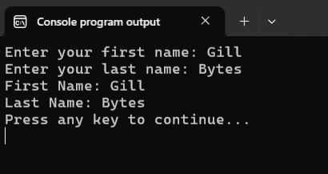

Теперь считывание строки организовано так:
1. `fgets` читает строку в массив.
2. `get_newline_position` ищет в ней `\n`.
3. Если `\n` найден, значит строка прочитана целиком -- заменяем `\n` на `\0`.
4. Если `\n` не найден, значит строка не поместилась -- очищаем `stdin` вызовом `discard_line`.

Эти четыре шага повторяются для каждой строки, поэтому вынесем их в функцию `get_string`. Будем передавать этой функции в качестве аргументов указатель на символьный массив и размер этого массива.

Листинг 19.
```c
#include <stdio.h>
#define MAX_LENGTH 25

void discard_line(void);
int get_newline_position(const char *str);
void get_string(char *str, int max_size);

int main(void)
{
        char first_name[MAX_LENGTH];
        char last_name[MAX_LENGTH];
        
        printf("Enter your first name: ");
        get_string(first_name, sizeof(first_name));

        printf("Enter your last name: ");
        get_string(last_name, sizeof(last_name));

        printf("First Name: %s\n", first_name);
        printf("Last Name: %s\n", last_name);
      
        return 0;
}

void get_string(char *str, int max_size)
{
        fgets(str, max_size, stdin);

        int newline_position = get_newline_position(str);
        if (newline_position >= 0) {
                str[newline_position] = '\0';  
        } else {
                discard_line();
        }
}

int get_newline_position(const char *str)
{
        int newline_position = -1;

        for (int i = 0; str[i]; i++) {
                if (str[i] == '\n') {
                        newline_position = i;
                        break;
                }
        }

        return newline_position;
}

void discard_line(void)
{
        int current_char; 

        do {
                current_char = getchar();
        } while (current_char != '\n' && current_char != EOF);  
}
```

Думаете, улучшать здесь уже нечего? Ошибаетесь! Например, мы не проверяем, что вернула функция `fgets`. Если поток ввода закончится раньше, чем будет прочитан хотя бы один символ, `fgets` вернёт `NULL` и не запишет в массив ничего, даже `\0`. Тогда `get_newline_position` будет читать неинициализированный массив, а это неопределённое поведение. Исправление этой проблемы оставим для дополнительных материалов к уроку, а сейчас поговорим о функции `gets`.

### Функция `gets` (устаревшая)

Функция `gets` (сокращение от get string) -- устаревший "аналог" `fgets` из `stdio.h`. Она читает строку из `stdin` в переданный массив, но размера массива не принимает. Поэтому останавливаться по достижении лимита она не умеет: читает до `\n` или до конца потока. Символ `\n` из потока забирает, но в массив вместо него пишет `\0`.

Рассмотрим следующий пример.

Листинг 20: Чтение строки функцией `gets`
```c
#include <stdio.h>

int main(void)
{
        char username[11];
        
        gets(username);  // НЕ НАДО ТАК
        puts(username);
        
        return 0;
}
```

")

На коротком вводе программа отрабатывает корректно. Проблема в другом: `gets` не знает размер массива и остановится только на `\n` или `EOF`. Если ввести больше `10` символов, запись пойдёт за границу массива `username`. Ошибки такого рода называют =переполнением буфера (buffer overflow)=.

% **Важно!** В стандарте `C99` функция `gets` объявлена устаревшей и не рекомендуется к использованию. В `C11` функция `gets` исключена из стандарта. В некоторых реализациях стандартной библиотеки она ещё поддерживается, но это не обязательно. Не используйте её.

### Спецификатор `%s` в функции `scanf`

Функция `scanf` с помощью спецификатора `%s` может прочитать одно "слово" из стандартного потока ввода. Под словом здесь понимается произвольная последовательность любых непробельных символов, например: `Gill`, `Bytes`, `gill.bytes@microsoft.com`, `zyurjlth`, `4282jir!vf%i4fs` и т.п. Важно, что в последовательности символов не должно быть пробельных символов: пробела, табуляции или переноса строки. Любой из этих символов является для спецификатора `%s` признаком окончания слова, как `\n` для `fgets`.

Посмотрим на примере:

Листинг 21.
```c
#include <stdio.h>

#define SIZE 11

int main(void)
{
        char first_name[SIZE];
        char last_name[SIZE];

        printf("Enter your first name and last name: ");
        scanf("%10s", first_name);
        scanf("%10s", last_name);

        printf("First Name: |%s|\n", first_name);
        printf("Last Name: |%s|\n", last_name);

        return 0;
}
```

")

Разберём вызов `scanf("%10s", first_name)`.

Как мы уже знаем, имя массива в выражениях превращается в адрес нулевого элемента. Поэтому при передаче символьного массива в функцию `scanf` не требуется оператор `&` перед именем переменной `first_name`.

Число `10` в `%10s` -- это максимальная ширина поля: максимальное количество символов, которые функция `scanf` может прочитать из потока ввода. В нашем примере размер массива `11` элементов, следовательно, десять из них отдаём под слово, а один под нуль-символ `\0`. Нуль-символ `scanf` дописывает самостоятельно. 

% **Важно!** В `printf` запись `%10s` определяет **минимальную** ширину поля для вывода. Короткая строка дополняется пробелами, а длинная печатается целиком. Но `%10s` в `scanf` -- это жёсткая верхняя граница на количество читаемых символов, прочитать больше функция не сможет. 

Если мы уберём ширину поля и оставим лишь `%s`, то функция не будет ничем ограничена, и мы получим потенциальную ошибку переполнения буфера.

% **Важно!** При использовании спецификатора `%s` в функции `scanf` **обязательно** указывайте максимальное количество символов для чтения!

Выше уже было сказано, что любой пробельный символ (пробел ` `, табуляция `\t` или перевод строки `\n`) является для спецификатора `%s` признаком окончания слова. При этом сам пробельный символ, на котором чтение остановилось, в массив не записывается, а остаётся в потоке ввода.

Любые пробельные символы, записанные перед словом, `scanf` просто проигнорирует. Поэтому `Gill` и `Bytes` можно записать в одну строку через пробел или на двух разных строках. Для `%s` перевод строки -- такой же разделитель, как пробел. Проверьте это самостоятельно.

Резюмируем, основное назначение спецификатора `%s` в функции `scanf` -- это чтение отдельных слов. Строку с пробелом внутри одним `%s` прочитать не выйдет. Главный недостаток этой функции в том, что ограничение на максимальный размер читаемого слова нужно прописать в формат-строке заранее. Это может быть неудобно.

Пробельный символ, оставшийся в потоке, может стать проблемой. Рассмотрим следующий пример.

Листинг 22.
```c
#include <stdio.h>

#define SIZE 11

int main(void)
{
        char first_name[SIZE];
        char comment[2 * SIZE];

        printf("Enter your first name: ");
        scanf("%10s", first_name);

        printf("Enter a comment: ");
        fgets(comment, sizeof(comment), stdin);

        printf("First Name: |%s|\n", first_name);
        printf("Comment: |%s|\n", comment);

        return 0;
}
```

")

Запускаем программу, вводим `Gill` и нажимаем `Enter`. Программа выводит подсказку для комментария и тут же, не дожидаясь ввода, печатает `first_name` и `comment`.


В поток ввода попадает `Gill\n`. Спецификатор `%s` прочитал из потока ввода `Gill`, добавил `\0` и записал получившуюся строку в массив `first_name`. Символ перевода строки `\n` остался в `stdin`. Вызванный следом `fgets` первым делом читает этот `\n`. Для него перевод строки -- это признак окончания ввода, поэтому он добавляет к нему нуль-символ и записывает получившуюся строку в `comment`. В итоге до ввода комментария дело не доходит.

Убрать этот `\n` можно уже знакомой `discard_line`: вызвать её после `scanf` и до `fgets`. Получается, мы снова используем свои "костыли" для нейтрализации особенностей библиотечных функций. Так, может быть, проще сразу написать свою функцию для посимвольного чтения данных?

## Посимвольное чтение данных

Собственно, это наиболее универсальный способ чтения строки из стандартного потока ввода, который доступен программисту на Си. Здесь мы вольны сами решать, когда остановиться, какие символы записывать в строку, а какие нет.

Для реализации этой идеи воспользуемся нашими наработками. Возьмём написанную ранее функцию `get_string` и перепишем её без использования функции `fgets`.

Листинг 23. Посимвольное чтение строк
```c
#include <stdio.h>
#define MAX_LENGTH 25

void discard_line(void);
int custom_get_string(char *str, int max_size);

int main(void)
{
        char first_name[MAX_LENGTH];
        char last_name[MAX_LENGTH];

        printf("Enter your first name: ");
        if (!custom_get_string(first_name, sizeof(first_name))) {
                printf("Input error!\n");
                return 1;
        }
        

        printf("Enter your last name: ");
        if (!custom_get_string(last_name, sizeof(last_name))) {
                printf("Input error!\n");
                return 1;
        }
        

        printf("First Name: |%s|\n", first_name);
        printf("Last Name: |%s|\n", last_name);

        return 0;
}

int custom_get_string(char *str, int max_size)
{
        if (max_size <= 0) {
                return 0;
        }

        int limit = max_size - 1; // сразу бронируем один символ для '\0'

        int current_char = getchar();
        if (current_char == EOF) { // если сразу EOF, завершаем работу
                return 0;
        }

        int i = 0;
        while (current_char != '\n' && current_char != EOF && i < limit) {
                str[i] = current_char;
                i++;
                current_char = getchar();
        }

        str[i] = '\0';

        if (current_char != '\n' && current_char != EOF) {
                discard_line();
        }

        return 1;
}

void discard_line(void)
{
        int current_char;

        do {
                current_char = getchar();
        } while (current_char != '\n' && current_char != EOF);
}
```

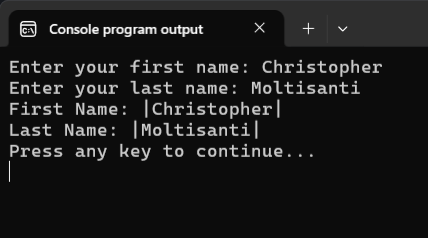

Разберём работу этой функции. 
Допустим, после запуска программы мы ввели `Gill` и нажали `Enter`. В поток `stdin` уходит `Gill\n`.

В массиве `first_name` всего `25` элементов. Один резервируем под нуль-символ, поэтому `limit = 24`.  

Цикл читает символы по одному и пишет их в массив, пока не встретит `\n`, `EOF` или не упрётся в `limit`. Для `Gill` он запишет четыре буквы и остановится, когда очередной `getchar` вернёт `\n`. Этот `\n` в массив не попадает: он остаётся в `current_char`. Следом в `str[4]` записывается `\0`, и по итогу в массиве лежит `Gill\0`. Завершающий `if` не срабатывает, т.к. цикл остановился на `\n` и хвост чистить не нужно.

Если символов до `\n` будет больше, чем `limit`, то цикл остановится по условию `i < limit`. В `current_char` окажется первый символ, который уже не поместился, а `\n` останется дальше в потоке. Тогда сработает завершающий `if` и вызовется `discard_line`. Читать «невлезший» символ заново не надо: `getchar` уже забрал его из потока.

Теперь, допустим, пользователь сразу нажимает `Enter`, т.е. фактически ничего не вводит. В `stdin` уходит `\n`. Первый `getchar` возвращает `\n`, поэтому тело цикла не выполняется ни разу, а в `str[0]` будет записан нуль-символ `\0`. Получаем в массиве пустую строку, и для пустого ввода это допустимый результат. Если же по условию задачи для нас пустой ввод недопустим, то мы можем сразу после цикла чтения добавить проверку и досрочный выход `if (i == 0) return 0;`.

По сути это почти та же `get_string`, что в Листинге 19, но с некоторыми нюансами и дополнениями. Во-первых, в `get_string` символ `\n` сначала попадал в массив, и его приходилось отдельно затирать. Здесь он в массив не попадает. 
Во-вторых, я добавил возвращаемое значение, которое использую для обработки ошибок.
Функция `custom_get_string` возвращает `int`:
- `1` — строка прочитана;
- `0` — читать нечего (сразу `EOF`) или некуда (`max_size` некорректный). 

Давайте очень кратко подытожим всё, изложенное ранее.

Более-менее безопасный способ считать строку -- это использовать функцию `fgets`. Если по условиям задачи нам достаточно прочитать строку по словам или строка имеет специфичный формат, то, вероятно, будет проще  использовать `scanf`. В обоих случаях стоит помнить про "хвосты", которые эти функции могут оставить в потоке ввода. Наиболее универсальный вариант чтения строки -- написать свой собственный посимвольный ввод, учитывающий все ограничения и нюансы задачи.

Ну, думаю, что мне удалось вам показать, что ввод строк в языке Си -- это та ещё морока. А это мы ещё упростили себе задачу, договорившись, что длина строки ограничена. А ведь мы могли бы использовать кучу. 

Выглядело бы это примерно так:
1. выделяем место в куче;
2. читаем стандартный поток ввода посимвольно и записываем в выделенную область памяти;
3. когда место заканчивается, то выделяем кусок памяти побольше;
4. копируем уже прочитанные данные из маленького кусочка памяти в новый кусок памяти;
5. освобождаем старый кусок памяти;
6. продолжаем чтение и запись в новый большой кусок памяти;
7. когда и если заканчивается место в этом новом большом куске памяти, возвращаемся к пункту `3`;
8. если дошли до конца строки или в потоке ввода кончились символы, то завершаем чтение строки и дописываем в массив `\0`;
9. PROFIT! Мы считали ОЧЕНЬ-ОЧЕНЬ длинную строку.
