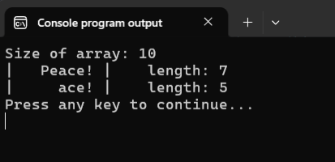
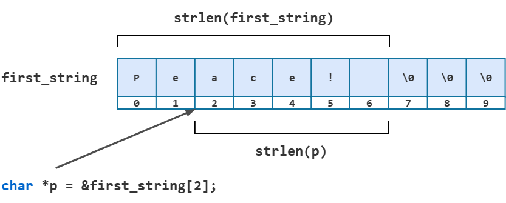
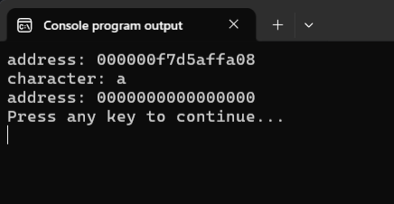
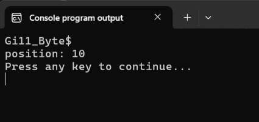
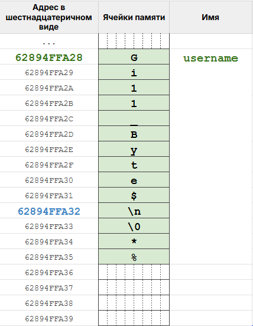
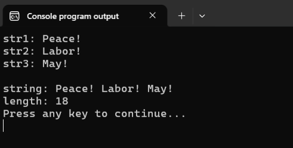
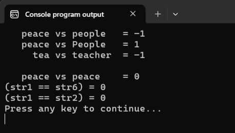
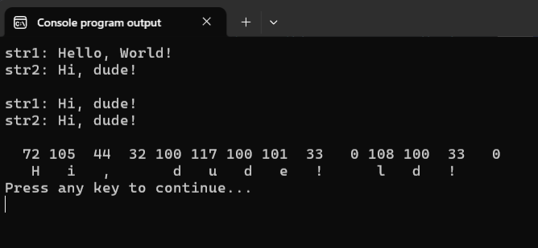
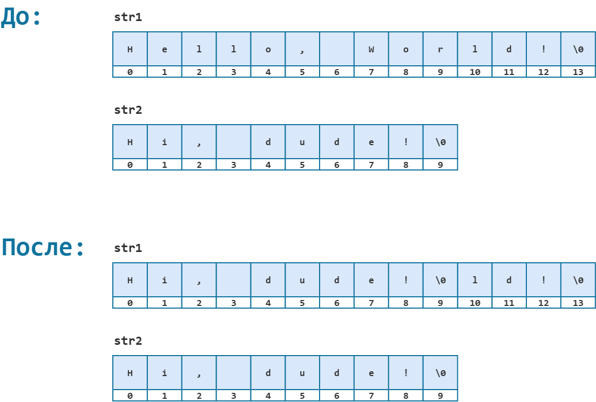

# Функции стандартной библиотеки для работы со строками

Для большинства стандартных операций, которые мы можем захотеть сделать со строками, стандартная библиотека языка Си предоставляет готовые функции. Их, конечно же, стоит изучить и использовать всегда, когда это возможно. Единственное исключение -- это практические задания, где вас просят реализовать функциональность той или иной стандартной функции. 

Мы разберём лишь пять самых базовых функций:

- `strlen` -- определяет длину строки;
- `strchr` -- ищет символ в строке;
- `strcat` -- склеивает две строки в одну;
- `strcmp` -- сравнивает строки;
- `strcpy` -- копирует строку в другой символьный массив.

% **Важно!** Все функции, разобранные в этом уроке, объявлены в заголовочном файле `string.h`. Чтобы их использовать, необходимо этот файл подключить директивой `#include`. Кроме того, напоминаю, что функции работают с корректными C-строками. Следить за корректностью передаваемых строк -- обязанность программиста.


## Функция `strlen`

Обычно говорят, что функция `strlen` вычисляет длину строки, переданной ей в качестве аргумента. Но есть небольшой нюанс. Если передать указатель не на начало строки, а на один из её символов, получится длина оставшейся части строки, а не всей исходной строки. Давайте посмотрим на прототип этой функции.

Листинг 1. Прототип функции `strlen`
```c
size_t strlen(const char *s);
```

**Входные параметры:**
- `s` -- указатель на **корректную** C-строку. Обратите внимание на квалификатор `const`: он подсказывает, что эта функция никак не изменит ту строку, которую мы ей передадим.

**Выходные параметры:**
- количество символов, которые предшествуют ближайшему нуль-символу, в символьном массиве, на который указывает указатель `s`.

Если указатель хранит адрес начала символьного массива, `strlen` вернёт длину строки. Но мы можем передать указатель на любой другой символ этой строки (мы проворачивали подобный трюк с функцией `puts`), тогда `strlen` будет считать символы уже начиная с него и до следующего ближайшего нуль-символа.

Продемонстрируем это на примере.

Листинг 2.
```c
#include <stdio.h>
#include <string.h>

int main(void)
{
        char first_string[10] = "Peace! ";
        
        printf("Size of array: %d\n", (int) sizeof(first_string));

        int length = strlen(first_string);
        printf("|%10s| \tlength: %d\n", first_string, length);


        char *p = &first_string[2];
        int len2 = strlen(p);
        printf("|%10s| \tlength: %d\n", p, len2);

        return 0;
}
```



Размер массива `first_string` -- `10` элементов. Причём сама строка (вместе с нуль-символом) занимает всего `8` из них. В остальных двух элементах лежат нули по правилу частичной инициализации. 

При вызове `strlen(first_string)` имя массива `first_string` по общему правилу преобразуется в указатель на начало массива, поэтому в результате мы получим `7` -- длину строки, записанной в массиве `first_string`.

Если же мы передаём в `strlen` указатель не на начало массива, а на элемент с индексом `2`, то теперь функция считает элементы до первого нуль-символа, начиная с этого места, а не с начала массива, поэтому мы получаем на выходе значение `5`.



Напоследок пара слов о типе возвращаемого значения. `size_t` -- это такой специальный псевдоним для беззнакового целочисленного типа, достаточно большого, чтобы в нём можно было сохранить размер любого объекта (например, массива), поддерживаемого в системе. Он используется во всех функциях и операторах, которые связаны с размерами объектов. Мы уже сталкивались с ними, когда знакомились с работой оператора `sizeof`. Т.к. мы работаем с достаточно маленькими строками и объектами, то для хранения их размеров вполне можно использовать и тип `int`. Но тогда, например, в строке `int length = strlen(first_string);` будет происходить неявное преобразование от `size_t` к `int`. 


## Функция `strchr`

Функция `strchr` находит первое вхождение символа внутри корректной C-строки. 

Листинг 3. Прототип функции `strchr` 
```c
char *strchr(const char *s, int c);
```

**Входные параметры:**
- `s` -- указатель на **корректную** C-строку.
- `c` -- код символа, который нужно найти в строке. Параметр имеет тип `int`, но перед сравнением значение приводится к типу `char`.  

**Выходные параметры:**
- функция возвращает указатель на `char` (`char *`), т.е. указатель на найденный символ. Если же такого символа в строке нет, то возвращается `NULL`. Нуль-символ считается частью строки: `strchr` может найти и его.

% **Обратите внимание!** Функция `strchr` возвращает указатель на элемент, а не позицию элемента в строке.

Продемонстрируем работу `strchr` на следующем примере.

Листинг 4. Демонстрация работы функции `strchr`
```c
#include <stdio.h>
#include <string.h>

int main(void)
{
        char first_string[10] = "Peace! ";
        
        char *p_a = strchr(first_string, 97);

        printf("address: %p\ncharacter: %c\n", p_a, *p_a);

        char *p_i = strchr(first_string, 'i');
        printf("address: %p\n", p_i);

        return 0;
}
```


В этой программе мы с помощью функции `strchr` ищем в строке `"Peace! "` символы `'a'` и `'i'`. В случае с символом `'a'` мы используем его код из ASCII-таблицы, число `97`. В обоих случаях функция `strchr` возвращает адрес, который мы сохраняем в переменную-указатель на тип `char`. Символа `'i'` в строке нет, поэтому второй вызов возвращает нулевой указатель. Его нельзя разыменовывать.

Кстати, в прошлом уроке мы самостоятельно написали урезанный аналог функции `strchr` -- функцию `get_newline_position` (Листинг 17). Она умела искать только символ `\n`, и возвращала его позицию в строке, а не указатель. Последуем совету из начала урока и перепишем функцию `get_newline_position` с использованием стандартной функции `strchr`. 

То, что функция `strchr` возвращает указатель, не создаст нам особых проблем, т.к. получив указатель на конкретный элемент строки, а также располагая указателем на начало строки, мы всегда можем получить позицию элемента, воспользовавшись адресной арифметикой. Для этого будет достаточно из полученного адреса элемента отнять адрес начала массива.

Листинг 5. Новая версия функции `get_newline_position`
```c
#include <stdio.h>
#include <string.h>

int get_newline_position(const char *str);

int main(void)
{
        char username[20];

        fgets(username, sizeof(username), stdin);

        int position = get_newline_position(username);
        
        printf("position: %d\n", position);

        return 0;
}


int get_newline_position(const char *str)
{
        int newline_position = -1;

        char *p_newline = strchr(str, '\n'); // ищем '\n' в строке str

        // если strchr вернула не NULL, то '\n' есть в строке
        // указатель на него лежит в p_newline
        if (p_newline != NULL) {                           
                // вычисляем позицию элемента с помощью адресной арифметики
                newline_position = p_newline - str;
        }

        return newline_position;
}

/* прошлая версия функции 
int get_newline_position(const char *str)
{
        int newline_position = -1;

        for (int i = 0; str[i]; i++) {
                if (str[i] == '\n') {
                        newline_position = i;
                        break;
                }
        }

        return newline_position;
}
*/
```



На следующем рисунке изображён массив `username` в оперативной памяти после того, как функция `fgets` записала в него строку из потока `stdin`:



Здесь символы `*` и `%` в конце массива символизируют мусор, который до этого лежал в этих ячейках оперативной памяти.

Функция `strchr` вернёт адрес `62894FFA32`, который будет записан в указатель `p_newline`. Так как указатель не нулевой, то мы можем вычислить позицию символа в строке. Для этого из адреса найденного элемента `62894FFA32` вычитаем адрес начала массива `62894FFA28`: `p_newline - str`. В десятичной системе счисления получаем: `423210514994 - 423210514984 = 10`. Это как раз индекс элемента `\n` в строке `Gi11_Byte$`. 

% **Важно!** Вычислять разность адресов можно исключительно для адресов, принадлежащих одному объекту (в нашем случае массиву `username`).


## Функция `strcat`

Функция `strcat` используется для склеивания двух строк. Ещё эту операцию называют =конкатенацией (concatenation)= строк.

Листинг 6. Прототип функции `strcat` 
```c
char *strcat(char *s1, const char *s2);
```

**Входные параметры:**
- `s1` и `s2` -- указатели на **корректные** C-строки. Массив, на который указывает `s1`, должен быть изменяемым, т.к. в него будет дописываться вторая строка.

**Выходные параметры:**
- указатель на начало первой строки, т.е. `s1`.

Функция `strcat` присоединяет к концу строки `s1` строку `s2`. Нуль-символ строки `s1` заменяется на первый символ строки `s2`. Возвращает она тот же указатель `s1`. В примере ниже мы это возвращаемое значение игнорируем и, как это часто бывает в языке Си, вызываем функцию для её побочного эффекта, а не ради возвращаемого значения.

% **Важно:** Программист самостоятельно должен следить за тем, чтобы в массиве, на который указывает `s1`, хватило места для обеих строк и завершающего нуль-символа. Области памяти, на которые указывают `s1` и `s2`, не должны перекрываться.

Листинг 7. Пример работы функции `strcat`
```c
#include <stdio.h>
#include <string.h>

int main(void)
{
        // объявляем три строки
        char str1[20] = "Peace! ";
        char str2[] = "Labor! ";
        char str3[] = "May!";

        // выводим строки на экран
        printf("str1: %s\n", str1);
        printf("str2: %s\n", str2);
        printf("str3: %s\n\n", str3);

        // присоединяем к первой строке вторую
        strcat(str1, str2);
        // теперь str1 = "Peace! Labor! "

        // присоединяем к первой строке третью
        strcat(str1, str3);
        // теперь str1 = "Peace! Labor! May!"

        // выводим на экран строку str1 и её длину
        printf("string: %s\nlength: %d\n", str1, (int)strlen(str1));
  
        return 0;
}
```



Длина `18` здесь получается так. В `"Peace! "` семь символов, в `"Labor! "` семь, в `"May!"` четыре: `7 + 7 + 4 = 18`. Ещё один байт занимает нуль-символ, итого `19`. В `str1` двадцать элементов, поэтому склейка помещается.


## Функция `strcmp`

Функция `strcmp` используется для посимвольного сравнения двух строк.  

Листинг 8. Прототип функции `strcmp`
```c
int strcmp(const char *s1, const char *s2);
```

**Входные параметры:**
- `s1` и `s2` -- указатели на **корректные** C-строки.  

**Выходные параметры:**
- одно целое число, зависящее от результата сравнения строк:
  - `0` -- строки эквивалентны;
  - положительное число -- строка `s1` "больше" строки `s2`;
  - отрицательное число -- строка `s1` "меньше" строки `s2`.

Стандарт языка Си гарантирует только знак этого числа. А конкретное значение вроде `1` или `-1` зависит от реализации стандартной библиотеки. Например, функция может вернуть разность кодов первых различающихся символов.

Давайте сперва разберёмся, что подразумевают, когда говорят, что какая-то строка "больше" другой. Рассмотрим для примера строки `peace` и `people`. Мы видим, что они отличаются в третьем символе, но какая из них больше? Как думаете? Если вы предположили, что `people` больше `peace`, т.к. `a` находится в английском алфавите раньше, чем символ `o`, то в целом вы дали верный ответ. Единственный нюанс состоит в том, что сравниваются не порядковые номера букв в алфавите, а коды символов в таблице `ASCII`. Для символа `a` это код `97`, а для символа `o` -- `111`. Первый различающийся символ в `peace` меньше, поэтому `strcmp("peace", "people")` вернёт отрицательное число. В моей системе это `-1`, но другая реализация стандартной библиотеки может вернуть разность кодов `97 - 111`, то есть `-14`.

Этот нюанс позволяет сравнить строки `peace` и `People`. В обычном алфавите `p` и `P` не отличаются, а в таблице `ASCII` их коды `112` и `80`, поэтому `strcmp` вернёт положительное число. Другая задача, которую помогает решить такой подход, -- сравнение строк `tea` и `teacher`. Начальные символы совпадают, но `tea` всё равно меньше `teacher`. Дело в том, что после в строке `"tea"` есть ещё нуль-символ `'\0'` с кодом `0`. Сравниваются `0` и `99` (код символа `'c'`), и `strcmp` вернёт отрицательное число.

Убедимся в сказанном на следующем примере:

Листинг 9.
```c
#include <stdio.h>
#include <string.h>

int main(void)
{
        char  str1[] = "peace",
              str2[] = "people",
              str3[] = "People",
              str4[] = "tea",
              str5[] = "teacher",
              str6[] = "peace";
        
        printf("%8s vs %-8s = %d\n", str1, str2, strcmp(str1, str2));
        printf("%8s vs %-8s = %d\n", str1, str3, strcmp(str1, str3));
        printf("%8s vs %-8s = %d\n\n", str4, str5, strcmp(str4, str5));


        printf("%8s vs %-8s = %d\n", str1, str6, strcmp(str1, str6));        
        printf("(str1 == str6) = %d\n", (str1 == str6));
        printf("(str1 == str2) = %d\n", (str1 == str2));

        return 0;
}
```



Как видите, наши теоретические рассуждения полностью подтверждаются результатами работы программы. Отдельно я хочу обратить ваше внимание на сравнения `str1 == str6` и `str1 == str2`, которые дают `0`, т.е. `ЛОЖЬ`. Сравнить две строки таким образом невозможно, т.к. `str1`, `str2` и `str6` в выражениях превращаются в указатели на начало соответствующих массивов и фактически происходит сравнение этих адресов, а не строк. Т.к. адреса эти различны, мы получаем `0` в обоих случаях. 

Если мы используем функцию `strcmp` нельзя полагаться на проверки вроде `strcmp(str1, str3) == 1`, т.к. значение, которое вернёт `strcmp` зависит от используемой реализации стандартной библиотеки. Для программы из Листинга 9 такая проверка была бы истинна, потому что стандартная библиотека яызка Си, установленная у меня на ПК, возвращает в таком случае `1`. Но другая реализация этой библиотеки могла бы вернуть разность кодов `32`, и сравнение с единицей уже не сработало бы.

% **Важно!** В условных выражениях сравнивайте результат, возвращаемы функцией `strcmp`, с нулём. Результат вызова `strcmp(s1, s2)`
- `< 0` -- если `s1` меньше `s2`; 
- `== 0` -- если `s1` эквивалентна `s2`; 
- `> 0` -- если `s1` больше `s2`. 


## Функция `strcpy`

Функция `strcpy` используется для копирования корректной C-строки в другой символьный массив.

Листинг 10. Прототип функции `strcpy`
```c
char *strcpy(char *s1, const char *s2);
```

**Входные параметры:**
- `s1` -- указатель на символьный массив для копирования;
- `s2` -- указатель на **корректную** C-строку. 

Обратите внимание, что содержимое массива, на который указывает `s1`, может и не быть корректной строкой.

**Выходные параметры:**
- указатель `s1`. 

Функция `strcpy` полностью копирует строку, на которую указывает `s2` (включая нуль-символ), в символьный массив, на который указывает `s1`. 

Разберём простой примерчик.

Листинг 11. Пример работы функции `strcpy`
```c
#include <stdio.h>
#include <string.h>

int main(void)
{
        char  str1[] = "Hello, World!",
              str2[] = "Hi, dude!";

        printf("str1: %s \nstr2: %s\n\n", str1, str2);

        strcpy(str1, str2);
        printf("str1: %s \nstr2: %s\n\n", str1, str2);
        
        int array_size = sizeof(str1);
        for (int i = 0; i < array_size; i++) {
                printf("%4d", str1[i]);
        }
        printf("\n");

        for (int i = 0; i < array_size; i++) {
                printf("%4c", str1[i]);
        }
        printf("\n");

        return 0;
}
```



% **Важно!** Программист должен самостоятельно следить за тем, чтобы в массиве, на который указывает `s1`, хватило места для строки `s2` вместе с нуль-символом. Области памяти, на которые указывают `s1` и `s2`, не должны перекрываться.

Помимо копирования строки `str2` в строку `str1` и вывода результата на экран, я дополнительно поэлементно вывел содержимое символьного массива `str1` после выполнения копирования. Обратите внимание, что в последних элементах массива остался хвост лежавшей там ранее строки `Hello, World!`. Функция `strcpy` завершает работу сразу после того, как скопирует нуль-символ строки `str2`, остальная часть массива `str1` не затрагивается. 

Состояния массивов `str1` и `str2` до и после работы функции `strcpy` изображено на следующем рисунке.



Заметьте, что мы снова игнорируем возвращаемое значение, т.к. для нас важен побочный эффект этой функции -- копирование строки, а не это значение.