# Двумерные массивы

Массивы, которые мы рассматривали до сих пор, были одномерными. Условно говоря, у нас был набор пронумерованных коробок, выстроенных в одну линию. Чтобы обратиться к конкретной коробке, достаточно знать одно число -- индекс (порядковый номер). Но некоторые данные гораздо удобнее было бы хранить в виде таблицы, а не в виде строки/столбика. 

### Табличные данные

Допустим, мы хотим создать собственную игру-лабиринт. Герой перемещается по полю, которое перегорожено стенами. Его цель -- из начальной точки добраться до выхода из лабиринта. Основой такой игры является карта уровня, изображающая лабиринт. Она могла бы выглядеть как-то так:

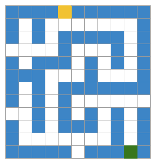

Жёлтая клетка -- вход, зелёная -- выход, синие клетки -- стены, белые -- проходы. Наша программа работать с картинкой не умеет, поэтому карту нужно как-то "оцифровать". Для этого договоримся кодировать каждую клетку карты числами: `1` -- стена, `0` -- проход, `3` -- вход, `9` -- выход.

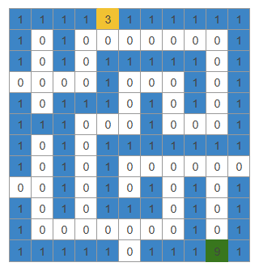

Получилась таблица из `12` строк и `11` столбцов, в каждой клетке которой записано целое число. Положение любой клетки удобнее всего описать двумя числами: номером строки и номером столбца. 

Другие примеры "табличных" данных:
- QR-код -- таблица из чёрных и белых квадратиков (те же `1` и `0`);
- поле для игры в крестики-нолики -- таблица `3` на `3`, в каждой клетке которой пусто, крестик или нолик;
- поле игры 2048 -- таблица `4` на `4` с числами;
- шахматная доска, поле для игры "Морской бой", таблица умножения, экран монитора (таблица пикселей) и пр.

Посмотрев на примеры, давайте разберёмся, как можно сохранить табличные данные в программе. Для наглядности будем рассматривать поле для игры в крестики-нолики.

Сперва попробуем обойтись теми инструментами, которые мы уже знаем, т.е. одномерными массивами.

Поле для игры в крестики-нолики состоит из `3` строк по `3` клетки. В каждой клетке может быть пусто, крестик или нолик. Условимся для хранения состояния клеток использовать значения типа `char`: `'X'` -- крестик, `'O'` -- нолик, а `'.'` -- пустая клетка. 

В такой "кодировке" поле, на котором первый игрок поставил крестик в центр, а второй ответил ноликом в правом верхнем углу, будет выглядеть следующим образом:
```
. . O
. X .
. . .
```

Как же сохранить такую табличку с помощью одномерных массивов?

#### Три одномерных массива

Первое, что приходит в голову: поле -- это три строки, а каждая строка -- это одномерный массив из трёх символов. Значит, создадим три массива: `row0`, `row1` и `row2`.

Листинг 1.
```c
#include <stdio.h>

#define SIZE 3

int main(void)
{
        char row0[SIZE] = { '.', '.', '.' };
        char row1[SIZE] = { '.', '.', '.' };
        char row2[SIZE] = { '.', '.', '.' };

        row1[1] = 'X'; // крестик в центр поля
        row0[2] = 'O'; // нолик в правый верхний угол

        // выводим поле на экран 
        // одна строка -- один цикл
        for (int j = 0; j < SIZE; j++) {
                printf("%c ", row0[j]);
        }
        printf("\n");

        for (int j = 0; j < SIZE; j++) {
                printf("%c ", row1[j]);
        }
        printf("\n");

        for (int j = 0; j < SIZE; j++) {
                printf("%c ", row2[j]);
        }
        printf("\n");

        return 0;
}
```

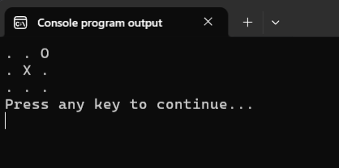

Всё получилось, но уже видны первые трудности. Для вывода игрового поля на экран мы три раза повторили один и тот же цикл. Это как-то не по-программистски. Как при таком подходе вывести поле для игры "Лабиринт"? Писать двенадцать циклов? А как передать такое поле в функцию (например, для вывода на экран)? Передавать 12 аргументов?


А это лишь полбеды. Задумаемся о том, как должен быть организован ход игрока. Допустим, он ввёл номер строки и номер столбца, а мы сохранили их в переменные `row` и `col`, соответственно. 

Пусть пользователь ввёл `1` и `1`. Теперь, используя эти данные, мы должны записать значение `'X'` в соответствующий одномерный массив. С номером столбца особых проблем не возникает. Это, по сути, индекс элемента в одном из трёх массивов.

А вот номер строки у нас "зашит" прямо в имя массива: `row0`, `row1`, `row2`. Имя переменной нельзя "собрать" из кусочков во время выполнения программы, компилятор должен знать его заранее, а значит, нам нужно использовать конструкцию `switch` или несколько конструкций `if`. Выглядеть это будет примерно вот так:

Листинг 2. 
```c
int row, col;
char player = 'X';

printf("Player %c, enter row and column: ", player);
scanf("%d %d", &row, &col);

switch (row) {
        case 0:
                row0[col] = player;
                break;
        case 1:
                row1[col] = player;
                break;
        case 2:
                row2[col] = player;
                break;
}
```


Ситуация похожа на ту, с которой мы столкнулись в заметке про одномерные массивы, когда заменили шесть переменных-счётчиков одним массивом. Тогда проблема была в отдельных переменных для каждого числа, а теперь -- в отдельных массивах для каждой строки. И решение у этой проблемы аналогичное -- объединить несколько массивов в новый двумерный массив, т.е. создать массив массивов! Но прежде чем мы научимся это делать, давайте разберём ещё один альтернативный вариант сохранить табличные данные с помощью одномерных массивов.

#### Один длинный одномерный массив

Раз проблема в том, что строки хранятся в разных массивах, давайте "склеим" их в один длинный массив. Создадим массив `field` из `9` элементов и договоримся, что первые три элемента -- это первая строка игрового поля, следующие три -- вторая, последние три -- третья:

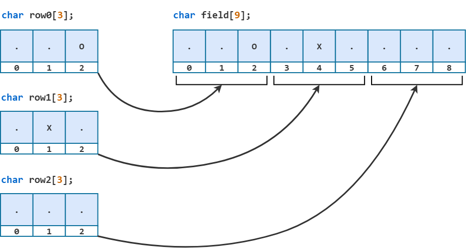

При таком подходе к хранению игрового поля индекс элемента в массиве `field` вычисляется по формуле `row * 3 + col`. 

Т.е. чтобы добраться до клетки в строке `row` и столбце `col`, нужно сначала пропустить `row * 3` элементов массива (`row` полных строк по `3` элемента в каждой), а потом сдвинуться ещё на `col` элементов вправо. 

Например: центральная клетка (строка `row = 1`, столбец `col = 1`). Подставляем эти значения в формулу и получаем: `1 * 3 + 1 = 4`. На рисунке выше в `field[4]` находится символ `X`. Теперь правый верхний угол (строка `row = 0`, столбец `col = 2`) даёт `0 * 3 + 2 = 2`. В `field[2]` сохранено значение `O`. 

Объединим Листинг 1 и Листинг 2 в единую программу, а заодно добавим новый формат хранения игрового поля.

Листинг 3.
```c
#include <stdio.h>

#define SIZE 3

int main(void)
{
        // создаём пустое поле
        char field[SIZE * SIZE] = { '.', '.', '.',
                                    '.', '.', '.',
                                    '.', '.', '.' };
        int row, col;

        char player = 'X';
        printf("Player %c, enter row and column: ", player);
        scanf("%d %d", &row, &col);
        field[row*SIZE + col] = player; 

        player = 'O';
        printf("Player %c, enter row and column: ", player);
        scanf("%d %d", &row, &col);
        field[row*SIZE + col] = player;

        // выводим поле на экран
        for (int i = 0; i < SIZE; i++) {
                for (int j = 0; j < SIZE; j++) {
                        printf("%c ", field[i*SIZE + j]);
                }
                printf("\n");
        }

        return 0;
}
```

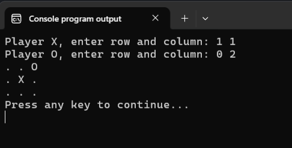

Начальные значения в списке инициализации я для наглядности разбил на три строки, но для компилятора это просто девять значений подряд. 

При таком подходе к хранению игрового поля инструкция `switch` уже не требуется. Формула `row*SIZE + col` автоматически превращает пару чисел `row` и `col` в правильный индекс для массива `field`.

Для вывода поля на экран мы использовали вложенные циклы. Внешний цикл по переменной `i` перебирает номера строк, а внутренний цикл по переменной `j` -- номера клеток внутри текущей строчки. Когда внутренний цикл заканчивается (т.е. все элементы строки уже выведены на экран), мы переводим строку, и внешний цикл переходит к следующей строке игрового поля. 

Этот вариант хранения табличных данных уже гораздо лучше. Теперь игровое поле стало единым объектом, у него есть собственное имя, его можно передать в функцию и достаточно легко вывести на экран. Но за это мы заплатили тем, что каждый раз вычисляем индекс элемента. Это не очень-то удобно, и, кроме того, это потенциальный источник ошибок. Было бы гораздо удобнее, если бы всю эту арифметику взял на себя компилятор. И, как я уже сказал ранее, такой способ есть!


## Что такое двумерный массив

=Двумерный массив= -- это массив, элементы которого нумеруются не одним, а двумя индексами: номером строки и номером столбца. Объявляется такой массив почти так же, как и одномерный, только необходимо указать обе размерности в отдельных квадратных скобках: сначала количество строк, затем количество столбцов.

Листинг 4. Общий синтаксис объявления двумерного массива
```c
тип_элементов имя_массива[количество_строк][количество_столбцов];
```

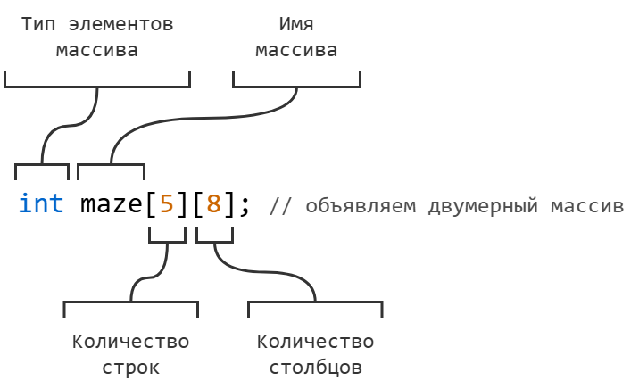

В результате объявления `int maze[5][8];` будет создан двумерный массив `maze` из `5` строк и `8` столбцов. На следующем рисунке этот массив изображён в виде таблицы: номера строк записаны слева, номера столбцов -- сверху. Нумерация и строк, и столбцов, как принято в языке Си, начинается с нуля. В ячейках массива "мусор", т.к. массив ещё не инициализирован.

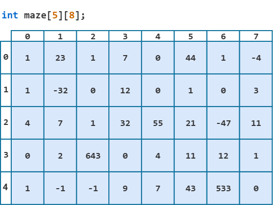

Ещё пара объявлений двумерных массивов:

Листинг 5.
```c
#define ROWS 12
#define COLS 11

char field[3][3];   // поле для крестиков-ноликов: 
                    // 3 строки по 3 клетки

int maze[ROWS][COLS];  // карта лабиринта с Рис.2: 
                       // 12 строк, 11 столбцов
```

Размеры двумерного массива должны быть конкретными числами, известными на этапе компиляции. Можно использовать именованные константы.

Важно понимать, что двумерный массив в языке Си -- это =массив массивов=, т.е. несколько одномерных массивов, объединённых в один новый массив.

Посмотрим, например, на массив `char field[3][3]`. Мы можем думать о нём как об одномерном массиве `field`, состоящем из трёх элементов: `field[0]`, `field[1]` и `field[2]`.

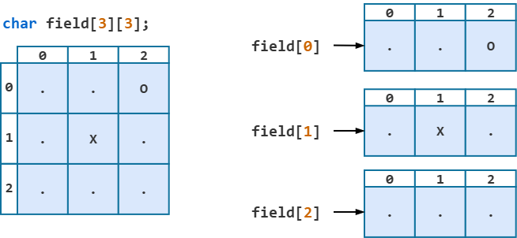

При этом каждый из элементов массива сам является одномерным массивом из `3` элементов типа `char`. То есть `field[0]`, `field[1]` и `field[2]` -- это три самых обычных одномерных массива типа `char[3]` (три строки игрового поля). По сути, это те самые `row0`, `row1` и `row2` из Листинга 1, которые мы объединили в единый массив с общим именем `field`, а номер строки, который раньше был частью имени переменной, превратился в обычный индекс.

Получается, что мы сперва научились объединять несколько обычных переменных в единый одномерный массив. А теперь взяли несколько одномерных массивов и аналогичным образом объединили их единый массив и получили двумерный массив. 

### Инициализация двумерного массива

Двумерный массив, как и одномерный, можно инициализировать при объявлении. Значения записываются в фигурных скобках, причём каждая строка -- в своих собственных фигурных скобках, вложенных в общие:

Листинг 6.
```c
int points[2][4] = { {1, 2, 4, 5}, {3, 4, -1, 0} };
```

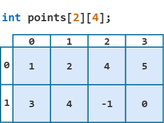

Внешние фигурные скобки -- это весь массив, внутренние -- отдельные строки. Первая пара внутренних скобок -- строка с индексом `0`, вторая -- строка с индексом `1`. Чтобы запись была похожа на таблицу, каждую строку массива обычно пишут на отдельной строчке кода:

Листинг 7.
```c
char field[3][3] = { {'.', '.', '.'},
                     {'.', '.', '.'},
                     {'.', '.', '.'} };
```

Правило частичной инициализации работает и здесь, причём сразу на двух уровнях:
- если внутри скобок какой-то строки значений меньше, чем столбцов, остаток этой строки заполняется нулями;
- если самих строк перечислено меньше, чем объявлено, недостающие строки целиком заполняются нулями.

Листинг 8.
```c
int arr[3][3] = { {1, 2, 3},  // получим:  1 2 3
                  {4, 5} };   //           4 5 0  <- строка дополнена нулём
                              //           0 0 0  <- этой строки не было в списке

int zeros[2][4] = {0};        // все 8 элементов равны нулю
```

Второе объявление -- уже знакомый трюк для обнуления массива любого размера: явно кладём `0` в `zeros[0][0]`, а всё остальное обнуляется само. Но, как и с одномерными массивами, работает это только с нулём. `int ones[2][3] = {1};` запишет единицу только в `ones[0][0]`, а `{ {1}, {1} }` -- только в нулевой столбец. Заполнить массив одинаковыми ненулевыми значениями можно только циклом.

Если же значений в какой-либо строке окажется больше, чем столбцов, или строк больше, чем объявлено, компилятор выдаст ошибку.

Ну а если массив не инициализировать начальными значениями, то в его элементах, как обычно, будет "мусор". Проверьте это самостоятельно.


### Обращение к элементу двумерного массива

Чтобы обратиться к отдельному элементу, после имени массива указываем два индекса, каждый в своих квадратных скобках: сначала номер строки, потом номер столбца.

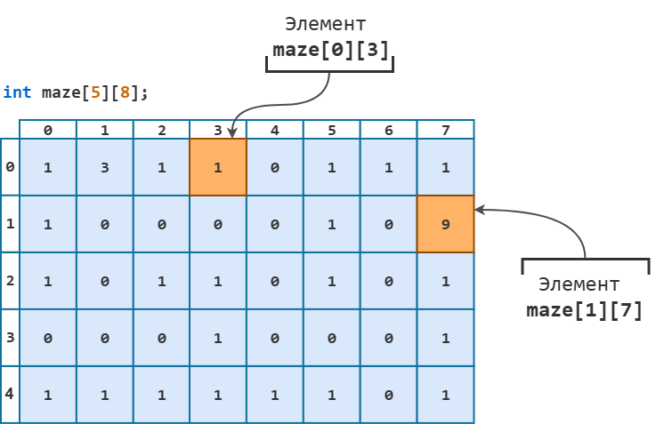

На рисунке `maze[0][3]` -- это элемент из строки с индексом `0` и столбца с индексом `3`, в нём хранится значение `1`. А `maze[1][7]` -- элемент из строки `1` и столбца `7`, в нём хранится значение `9`.

Запись с двумя индексами можно интерпретировать и по-другому, через "массив массивов": `maze[1]` -- это строка с индексом `1` (одномерный массив из `8` чисел), а следующие скобки `[7]` -- элемент с индексом `7` внутри этой строки. То есть два индекса -- это просто два обычных оператора индексации, применённых по очереди: сначала выбрали строку, потом элемент в ней.

% **Важно!** 
Первый индекс -- номер строки. 
Второй индекс -- номер столбца. 
Нумерация и строк, и столбцов начинается с нуля. 
`arr[1][2]` и `arr[2][1]` -- это разные элементы.

С элементом двумерного массива можно работать как с обычной переменной соответствующего типа: выводить на экран, присваивать значение и пр. И главное: как и в одномерном массиве, в квадратных скобках `[]` могут стоять не только числа, но и переменные или целочисленные выражения.

% **Частая ошибка!** Писать, как в математике, два индекса через запятую в одних скобках `arr[1, 2]`. Это ошибка. Такая запись означает совсем не то, что вы имели в виду. В лучшем случае вы получите ошибку компиляции, а в худшем -- предупреждение, которое легко пропустить. 
У каждого индекса -- свои квадратные скобки.

Давайте перепишем программу из Листинга 3 с использованием двумерного массива.

Листинг 9.
```c
#include <stdio.h>

#define SIZE 3

int main(void)
{
        char field[SIZE][SIZE] = { {'.', '.', '.'},
                                   {'.', '.', '.'},
                                   {'.', '.', '.'} };
        int row, col;

        char player = 'X';
        printf("Player %c, enter row and column: ", player);
        scanf("%d %d", &row, &col);
        field[row][col] = player; 

        player = 'O';
        printf("Player %c, enter row and column: ", player);
        scanf("%d %d", &row, &col);
        field[row][col] = player;

        // выводим поле на экран
        for (int i = 0; i < SIZE; i++) {
                for (int j = 0; j < SIZE; j++) {
                        printf("%c ", field[i][j]);
                }
                printf("\n");
        }

        return 0;
}
```

Если в Листинге 3 мы писали `field[row * SIZE + col]`, то здесь -- `field[row][col]`. Вся арифметика исчезла, и сама запись сразу подсказывает к какому элементу мы обращаемся: "элемент в строке `row` и столбце `col`". Вычислять, где именно в памяти располагается соответствующее значение, теперь обязанность компилятора. И чуть позже мы выясним, как он это делает.

Важно помнить про выход за границы массива. Следить за этим, как и прежде, должен сам программист, причём следить вдвое строже, ведь за допустимый диапазон значений не должен выходить ни первый, ни второй индексы. Например, для массива `char field[3][3]` обращение к `field[3][0]` или к `field[1][3]` приведёт к неопределённому поведению.


### Перебор элементов массива

Вывод игрового поля на экран в Листинге 9 организован через вложенные циклы, и это стандартный способ пройтись по всем элементам двумерного массива. Давайте разберём его чуть подробнее.

Допустим, в программе объявлен массив `arr[ROWS][COlS]`. Рассмотрим следующую конструкцию.

Листинг 10. Перебор элементов массива
```c
for (int i = 0; i < ROWS; i++) {          // перебираем строки
        for (int j = 0; j < COLS; j++) {  // перебираем столбцы внутри строки i
                // здесь работаем с элементом arr[i][j]
        }
}
```

Внешний цикл перебирает номера строк: переменная `i` принимает значения от `0` до `ROWS - 1`. Для каждого значения `i` (т.е. для каждой строки) полностью выполняется внутренний цикл, т.е. переменная `j` пробегает все значения (столбцы) от `0` до `COLS - 1`. Таким образом, элементы массива перебираются в следующем порядке:

```
i = 0:  arr[0][0], arr[0][1], arr[0][2], ..., arr[0][COLS - 1]

i = 1:  arr[1][0], arr[1][1], arr[1][2], ..., arr[1][COLS - 1]

i = 2:  arr[2][0], arr[2][1], arr[2][2], ..., arr[2][COLS - 1]

и т.д.
```

Мы как бы идём по элементам массива построчно: слева направо, сверху вниз -- так же, как мы читаем текст.

Следующая программа заполняет массив из `4` строк и `8` столбцов числами по порядку, а потом выводит его на экран.

Листинг 11.
```c
#include <stdio.h>

#define ROWS 4
#define COLS 8

int main(void)
{
        int arr[ROWS][COLS] = {0};
        int counter = 1;

        // заполняем массив числами по порядку
        for (int i = 0; i < ROWS; i++) {
                for (int j = 0; j < COLS; j++) {
                        arr[i][j] = counter;
                        counter++;
                }
        }

        // выводим массив на экран
        for (int i = 0; i < ROWS; i++) {
                for (int j = 0; j < COLS; j++) {
                        printf("%3d", arr[i][j]);
                }
                printf("\n");
        }

        return 0;
}
```

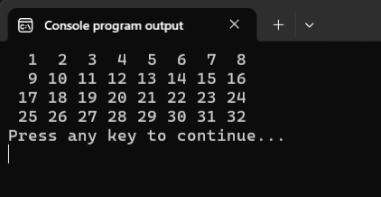

Чтобы вывести массив на экран в виде таблицы, я добавил `printf("\n");` сразу после внутреннего цикла. Таким образом одна итерация внешнего цикла выводит на экран одну строка массива. 

Для аккуратного вывода я использовал спецификатор `%3d`, чтобы каждое число выводилось в поле шириной в три символа. За счёт этого столбцы на экране получаются ровными. 


Заполнение двумерного массива значениями с клавиатуры устроено точно так же: вложенные циклы и `scanf("%d", &arr[i][j])` в теле внутреннего цикла. Следующая программа читает с клавиатуры элементы массива, а затем выводит получившийся массив на экран.

Листинг 12.
```c
#include <stdio.h>

#define ROWS 4
#define COLS 4

int main(void)
{
        int arr[ROWS][COLS] = {0};

        // заполняем массив числами
        // с клавиатуры
        for (int i = 0; i < ROWS; i++) {
                for (int j = 0; j < COLS; j++) {
                        scanf("%d", &arr[i][j]);
                }
        }

        // выводим массив на экран
        for (int i = 0; i < ROWS; i++) {
                for (int j = 0; j < COLS; j++) {
                        printf("%3d", arr[i][j]);
                }
                printf("\n");
        }

        return 0;
}
```

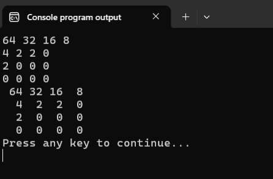

Обратите внимание, что я вводил числа по четыре в строке, как таблицу, но это не обязательно. Как мы уже знаем, функция `scanf` пропускает перед числом любые пробельные символы, причём пробелы и переводы строк для неё неотличимы. Поэтому эти `16` чисел можно ввести как угодно: все в одну строку через пробел, по одному в строке или ещё каким-нибудь экзотическим способом -- результат будет тот же. Проверьте это самостоятельно.

## Как двумерный массив хранится в памяти

Мы представляем двумерный массив в виде таблицы, но оперативная память -- это, как мы помним, просто длинная лента пронумерованных однобайтовых ячеек. Никаких строк и столбцов в ней нет. Как же в таком случае в ней размещается двумерный массив?

Очень просто: двумерный массив, как и одномерный, занимает один непрерывный блок памяти. В этом блоке строки массива лежат друг за другом: сначала все элементы строки `0`, сразу за ними все элементы строки `1`, затем строки `2` и т.д. Для массива `char field[3][3]` это `9` байт подряд:

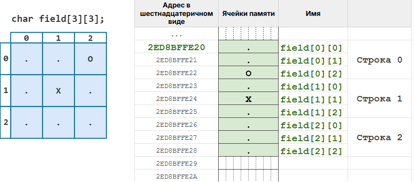

Узнали? Это же в точности наш "длинный" массив из Листинга 3! То есть в оперативной памяти двумерный массив хранится ровно так же, как одномерный массив из `ROWS * COLS` элементов, в котором строки записаны одна за другой.

Убедимся в этом с помощью следующей небольшой программки.

Листинг 13.
```c
#include <stdio.h>

#define ROWS 2
#define COLS 3

int main(void)
{
        int arr[ROWS][COLS] = { {1, 2, 4}, {9, 16, 25} };

        for (int i = 0; i < ROWS; i++) {
                for (int j = 0; j < COLS; j++) {
                        printf("arr[%d][%d] = %2d   address: %p\n", i, j, arr[i][j], &arr[i][j]);
                }
        }

        printf("\nsizeof(arr) = %zu\n", sizeof(arr));
        printf("sizeof(arr[0]) = %zu\n", sizeof(arr[0]));
        printf("sizeof(arr[0][0]) = %zu\n", sizeof(arr[0][0]));

        return 0;
}
```

Результат работы программы представлен на следующем рисунке (у вас, конечно, адреса будут другие):

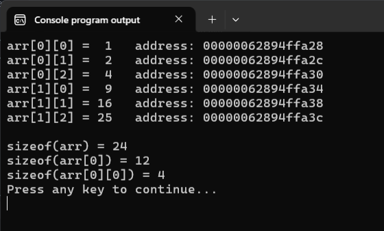

Для большей наглядности изобразим этот же массив на нашей модели оперативной памяти:

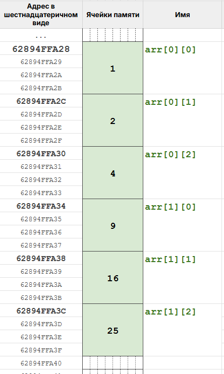

Адреса идут подряд с шагом в `4` байта (размер `int` у меня в системе). Никакого зазора между строками нет, вторая строка начинается сразу же за первой.

Посмотрим ещё, какие значения выдаст оператор `sizeof`:
- `sizeof(arr)` -- размер всего массива: `2 * 3 = 6` элементов по `4` байта, итого `24` байта;
- `sizeof(arr[0])` -- размер одной строки, т.е. одномерного массива `int[3]`: `3 * 4 = 12` байт;
- `sizeof(arr[0][0])` -- размер одного элемента: `4` байта.

Кстати, используя эти данные, мы всегда можем вычислить количество строк `sizeof(arr) / sizeof(arr[0])` и количество столбцов `sizeof(arr[0]) / sizeof(arr[0][0])` в двумерном массиве. Как и для одномерных массивов, этот трюк сработает только там, где `arr` всё ещё массив, а не указатель.


## Передача двумерного массива в функцию

В заметке про массивы и указатели мы выяснили, что при передаче массива в функцию попадает не сам массив, а указатель на его нулевой элемент, поэтому функция ничего не знает о размере массива, и размер приходится передавать отдельным параметром. С двумерными массивами ситуация похожая, но с одним важным нюансом.

В выражениях имя двумерного массива преобразуется в адрес нулевого элемента массива. При чём этот адрес интерпретируется как адрес всей нулевой строку массива. Например, для массива `char field[3][3]` имя массива `field` в выражениях превращается в указатель на целую строку `field[0]` (на массив `char[3]`), а не на отдельный символ `field[0][0]` (т.е. элемент типа `char`).

Что это значит на практике? Это значит, что в прототипе функции, в которую мы хотим передать массив `field` мы не можем написать `void fun(char *arr)`. В этом записи функция `fun` ожидает указатель на `char`, а мы ей передадим указатель на массив из трёх элементов типа `char`.

Самый простой выход из этой ситуации использовать запись с квадратными скобками, например:  

Листинг 14. Заголовок функции, принимающей двумерный массив
```c
void print_field(char field[][3]);    // количество строк не указано, количество столбцов -- обязательно
void print_field(char field[3][3]);   // так тоже можно, первый размер компилятор просто проигнорирует
```

% **Важно!** 
Если мы хотим передать двумерный массива в качестве аргумента в функцию, то в прототипе этой функции обязательно указывать количество столбцов, при этом количество строк можно опустить.

Почему так? Давайте подумаем, что функция должна уметь делать с массивом, который мы ей передаём? Как минимум -- находить по нему любой элемент `field[i][j]`. Мы только что видели, как строки лежат в памяти: одна за другой, без зазоров. Чтобы добраться до строки `i`, нужно пропустить `i` строк, а чтобы внутри строки добраться до столбца `j`, сдвинуться ещё на `j` элементов. Это та самая формула `i*COLS + j`, которую мы вручную считали в Листинге 3. И для неё компилятору обязательно нужно знать величину `COLS` -- длину одной строки массива, т.е. количество столбцов. А вот сколько всего строк в массиве, для вычисления адреса в памяти не важно.

У этого правила есть одно приятное следствие. Количество столбцов стало частью типа параметра, а типы компилятор проверяет. Если объявить `void print_field(char field[][3]);` и попытаться передать в неё массив `char board[4][4]`, компилятор пожалуется на несовпадение типов указателей (`incompatible pointer types` -- предупреждение или ошибка, в зависимости от компилятора и его версии). Для языка Си, который обычно ничего не проверяет за программиста, это редкая подстраховка: незаметно передать в функцию "неподходящий" двумерный массив не выйдет.

Всё остальное работает так же, как и с одномерными массивами:
- внутри функции `sizeof(field)` вернёт размер указателя, а не массива, поэтому трюк с вычислением размера через `sizeof` в функции не работает;
- копия массива не создаётся: функция работает с оригиналом массива, и все изменения элементов внутри функции отражаются на массиве, объявленном в `main`. Поэтому одна функция может, например, очистить поле, а другая -- вывести его на экран.

Давайте напишем заготовку для игры в крестики-нолики, содержащую функции:
- `clear_field` -- заполняет все клетки поля символом `.`;
- `print_field` -- выводит поле на экран вместе с номерами строк и столбцов, чтобы игрокам было проще вводить координаты.

Листинг 15. Заготовка для игры "Крестики-нолики"
```c
#include <stdio.h>

#define SIZE 3
#define EMPTY '.'

void clear_field(char field[][SIZE]);
void print_field(char field[][SIZE]);

int main(void)
{
        char field[SIZE][SIZE];
        char player = 'X';      // чей сейчас ход
        char winner = EMPTY;    // победитель (пока его нет)
        int moves = 0;          // количество сделанных ходов
        
        int row, col;           // координаты текущего хода

        clear_field(field);
        print_field(field);

        while (moves < SIZE * SIZE && winner == EMPTY) {
                printf("Player %c, enter row and column: ", player);
                scanf("%d %d", &row, &col);

                field[row][col] = player;
                moves++;

                print_field(field);

                // передаём ход другому игроку
                if (player == 'X') {
                        player = 'O';
                } else {
                        player = 'X';
                }
        }

        return 0;
}

// заполняет все клетки поля символом EMPTY
void clear_field(char field[][SIZE])
{
        for (int i = 0; i < SIZE; i++) {
                for (int j = 0; j < SIZE; j++) {
                        field[i][j] = EMPTY;
                }
        }
}

// выводит поле на экран вместе с номерами строк и столбцов
void print_field(char field[][SIZE])
{
        printf("\n  "); // начинаем с новой строки + делаем сдвиг в 2 пробела

        // печатаем номера столбцов
        for (int j = 0; j < SIZE; j++) {
                printf("%d ", j);
        }
        printf("\n");

        // печатаем игровое поле
        for (int i = 0; i < SIZE; i++) {
                printf("%d ", i); // перед каждой строкой печатаем её номер

                for (int j = 0; j < SIZE; j++) {
                        printf("%c ", field[i][j]);
                }
                printf("\n");
        }
        printf("\n");
}
```

В функции `main` игроки по очереди вводят координаты клетки. Программа добавляет метку игрока на игровое поле, и ход передаётся следующему игроку.

Переменная `winner` в программе не меняется -- определение победителя и проверку ввода пользователя оставим для самостоятельной практики.

Фрагмент одной из партий представлен на рисунке ниже:

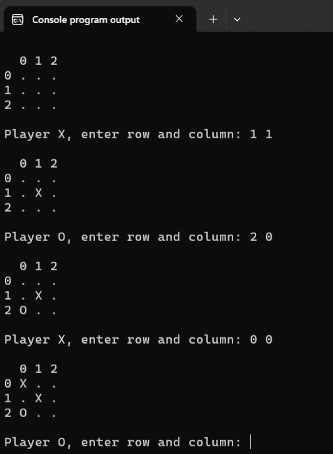

Несколько дополнительных комментариев к программе.

Функция `print_field` первым циклом печатает номера столбцов (шапку таблицы), а затем с помощью вложенных циклов печатает само игровое поле, причём перед каждой строкой дополнительно выводит её номер.

Обратите внимание, что массив `field` передаётся в функции просто по имени. Как мы помним, имя массива преобразуется в выражениях в указатель на его нулевой элемент, поэтому `&` здесь не нужен. Точно так же мы передавали в функции одномерные массивы. 

Т.к. размер массива задаётся именованной константой, то я решил не передавать в функции `clear_field` и `print_field` дополнительные аргументы, содержащие количество строк и количество столбцов в массиве.


### Строка двумерного массива -- это обычный одномерный массив

Напоследок ещё одно следствие того, что двумерный массив -- это массив массивов. Раз `field[1]` -- это полноценный массив `char[3]`, его можно передать в любую функцию, которая работает с одномерными массивами и про двумерные ничего не знает:

Листинг 16. Передача строки двумерного массива в функцию для одномерных массивов
```c
#include <stdio.h>

#define SIZE 3

// функция для вывода одномерного массива
void print_row(char row[], int size)
{
        for (int j = 0; j < size; j++) {
                printf("%c ", row[j]);
        }
        printf("\n");
}

int main(void)
{
        char field[SIZE][SIZE] = { {'.', '.', 'O'},
                                   {'.', 'X', '.'},
                                   {'.', '.', '.'} };

        printf("Middle row: ");
        print_row(field[1], SIZE);   // выводим среднюю строку игрового поля

        printf("\nWhole field:\n");
        for (int i = 0; i < SIZE; i++) {
                print_row(field[i], SIZE);  // всё поле, строка за строкой
        }

        return 0;
}
```

В функцию `print_row` попадает указатель на нулевой элемент строки `field[1]`, т.е. на `field[1][0]`, и дальше функция работает с ним точно так же, как работала бы с любым массивом `char[3]`. Запомните этот приём: задачу "сделать что-то с каждой строкой таблицы" часто проще всего решить функцией для одномерного массива, вызванной в цикле для каждой строки.


## Краткая шпаргалка по двумерным массивам

- **Объявление.** Сначала строки, потом столбцы, размеры -- константы: `int arr[ROWS][COLS];`

- **Инициализация.** Каждая строка -- в своих фигурных скобках, недостающие значения -- нули: `int a[2][3] = { {1, 2, 3}, {4} };` Обнулить всё: `int a[2][3] = {0};`

- **Доступ к элементу.** Два индекса, каждый в своих скобках, нумерация с нуля: `arr[row][col]`. Не `arr[row, col]`.

- **Построчный обход массива.** Внешний цикл по строкам (`i < ROWS`), внутренний по столбцам (`j < COLS`), внутри -- `arr[i][j]`. Перевод строки `\n` -- после внутреннего цикла.

- **В памяти.** Один непрерывный блок, строки лежат подряд; `arr[i][j]` -- это элемент номер `i * COLS + j` от начала блока.

- **Передача в функцию.** Число столбцов в параметре обязательно, число строк -- отдельным аргументом: `void f(int arr[][COLS], int rows);` Вызов по имени, без `&`: `f(arr, ROWS);` Функция работает с оригиналом, копии нет.

- **Границы.** Компилятор не проверяет ни один из индексов. Для `int arr[3][4]` допустимы только `arr[0..2][0..3]`, всё остальное -- неопределённое поведение.