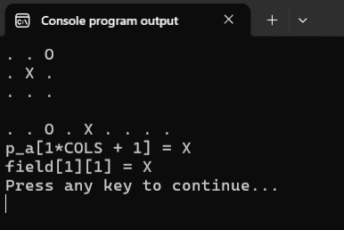

## Практика

- Решите [задачи с автоматической проверкой решения на Stepik](https://stepik.org/lesson/64657/step/1)

<div class="lessonStepikBlock">
    <iframe src="https://stepik.org/lesson/64657/step/1"></iframe>
</div>

- В Листинге 3 вывод игрового поля на экран осуществляется с помощью двух вложенных циклов. Попробуйте переписать вывод игрового поля на экран с помощью одного цикла `for` и инструкции `if`. Свой вариант решения можете опубликовать в комментариях к этому уроку.

- Убедитесь, что если не инициализировать двумерный массив, то в его элементах будет записан мусор.

- Внутренние скобки при инициализации компилятор, строго говоря, разрешает не писать, поэтому следующий пример тоже скомпилируется, и значения разложатся по строкам по порядку: сначала заполнится строка `0`, затем строка `1`, а строка `2` останется нулевой. 

```c
#include <stdio.h>

#define SIZE 3

int main(void)
{
        int arr[SIZE][SIZE] = { 1, 2, 3, 4, 5, 6 };
        
        for (int i = 0; i < SIZE; i++) {
                for (int j = 0; j < SIZE; j++) {
                        printf("%d ", arr[i][j]);
                }
                printf("\n");
        }

        return 0;
}
```

Но по такой записи не видно, где заканчивается одна строка и начинается другая, а при частичной инициализации вроде `{ 1, 2, 3, 4 }` легко ошибиться, какие именно элементы получили значения. Некоторые компиляторы на такое объявление выдадут предупреждение. Проверьте, как отреагирует ваш компилятор, и напишите об этом в комментариях к уроку.

- Скомпилируйте и запустите программу из Листинга 12. Попробуйте вводить значения различными способами.


### Исследовательские задачи для хакеров

**1.** Есть несколько разных способов работать с элементами двумерного массива через указатели и адресную арифметику.

Например, сохраним адрес `&field[0][0]` (самый первый элемент двумерного массива) в обычный указатель `p_a` и попробуем с его помощью поработать с отдельными элементами двумерного массива `field`, используя наши знания об адресной арифметике и об устройстве двумерных массивов в памяти.

```c
#include <stdio.h>

#define ROWS 3
#define COLS 3

int main(void)
{
        char field[ROWS][COLS] = { {'.', '.', 'O'},
                                   {'.', 'X', '.'},
                                   {'.', '.', '.'} };

        char *p_a = &field[0][0]; // адрес самого первого элемента массива
                           
        // обходим двумерный массив с помощью вложенных циклов
        // и адресной арифметики
        for (int i = 0; i < ROWS; i++) {
                for (int j = 0; j < COLS; j++) {
                        printf("%c ", *(p_a + i*COLS + j)); // то же самое, что field[i][j]
                }
                printf("\n");
        }
        printf("\n");
        
        // перебираем элементы двумерного массива
        // будто это один длинный одномерный массив
        for (int k = 0; k < ROWS * COLS; k++) {
                printf("%c ", *(p_a + k)); // то же самое, что p_a[k] 
        }
        printf("\n");

        int row = 1, col = 1;
        // обращаемся к центральному элементу через 
        // указатель p_a и формулу из Листинга 3.
        printf("p_a[%d*COLS + %d] = %c\n", row, col, p_a[row*COLS + col]);

        // и через два индекса
        printf("field[%d][%d] = %c\n", row, col, field[row][col]);

        return 0;
}
```



Указатель `p_a` ничего не знает ни о массивах, ни о строках, ни о столбцах. В нём просто хранится адрес какого-то значения типа `char`. Но зато мы с вами знаем, что начиная с этого адреса располагаются `9` элементов массива `field`, каждый из которых занимает по одному байту (размер типа `char`). А раз так, то обращаться к ним можно как к элементам одномерного массива: либо через оператор индексации `[]`, либо через адресную арифметику и оператор доступа по адресу `*`.

Выражения `p_a[i*COLS + j]`, `*(p_a + i*COLS + j)` и `field[i][j]` по сути обращаются к одному и тому же месту в оперативной памяти, просто в первых двух случаях вычисляем местоположение ячейки в памяти мы, а в третьем -- компилятор.

Разберитесь, как работают следующие варианты обращения к элементу двумерного массива: 
- `*(arr[i] + j)` 
- `*(*(arr + i) + j)`

**2.** В уроке было отмечено, что в выражениях имя массива превращается в указатель на самый первый элемент. Замените в коде выше явный адрес самого первого элемента `&field[0][0]` на имя массива `field`. Попробуйте скомпилировать и запустить получившийся код. Какую ошибку или предупреждение выдал компилятор? В чём проблема?

**3.** В уроке сказано, что внутри функции `sizeof(field)` вернёт размер указателя. Проверьте это, а заодно выясните, что внутри функции `void f(char field[][3])` вернут `sizeof(field[0])` и `sizeof(field[0][0])`. Сравните с результатами тех же выражений в `main` и объясните, почему число столбцов функция вычислить может, а число строк -- нет.

**4.** Функция `print_field(char field[][SIZE])` умеет работать только с таблицами из `SIZE` столбцов. А как написать функцию, которая может напечатать целочисленный двумерный массив любого размера? Передать в функцию указатель на первый элемент и оба размера.

```c
void print_table(int *data, int rows, int cols)
{
        // допишите тело функции
}
```

Объявите два массива разных размеров, например `int a[2][3]` и `int b[4][5]`, и выведите оба одной и той же функцией: `print_table`.
